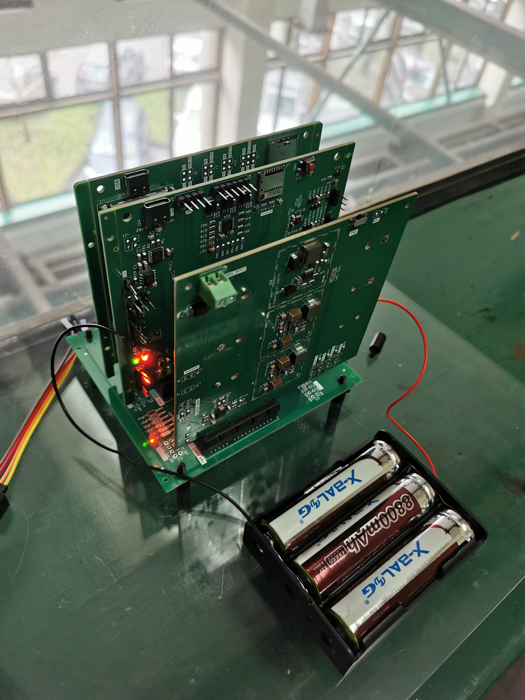
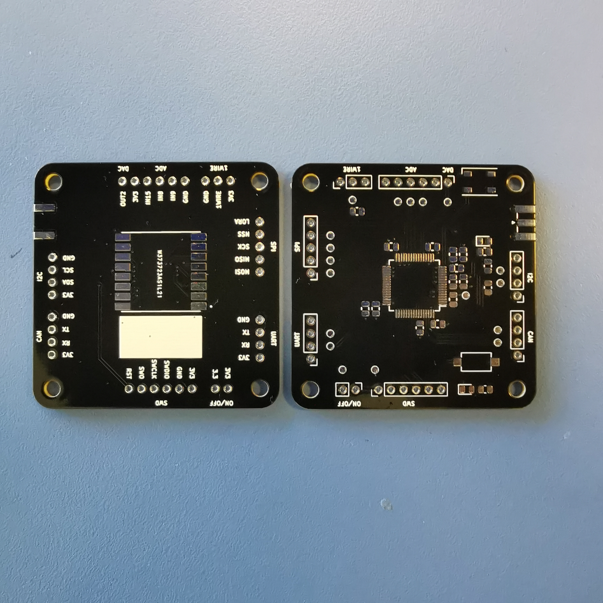
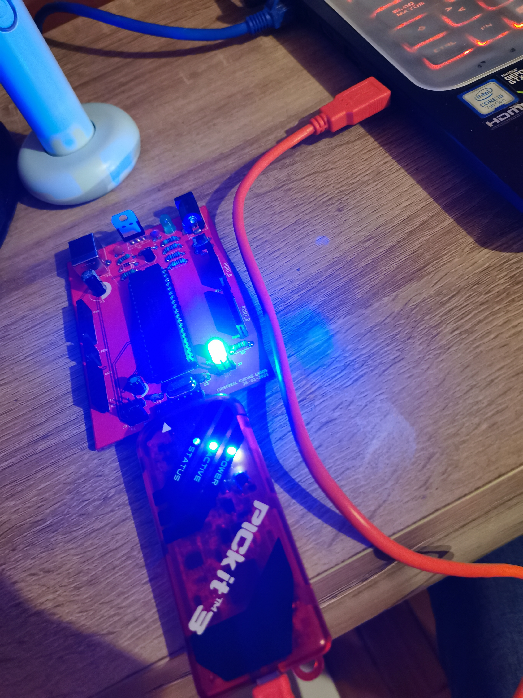

<!-- boardrepo-badge:v1 -->

<!-- /boardrepo-badge:v1 -->

# Kicad
Projects with Kicad

### [HornSystem](/HornSystem)

### [LoRaPill](/LoRaPill)

### [PIC18F4550](/PIC18F4550)

### [Shield ESP32](/Shield%20ESP32)

